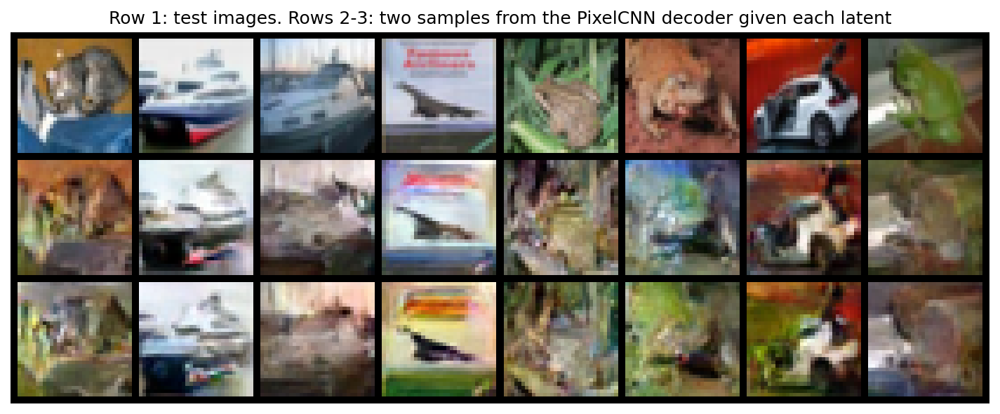
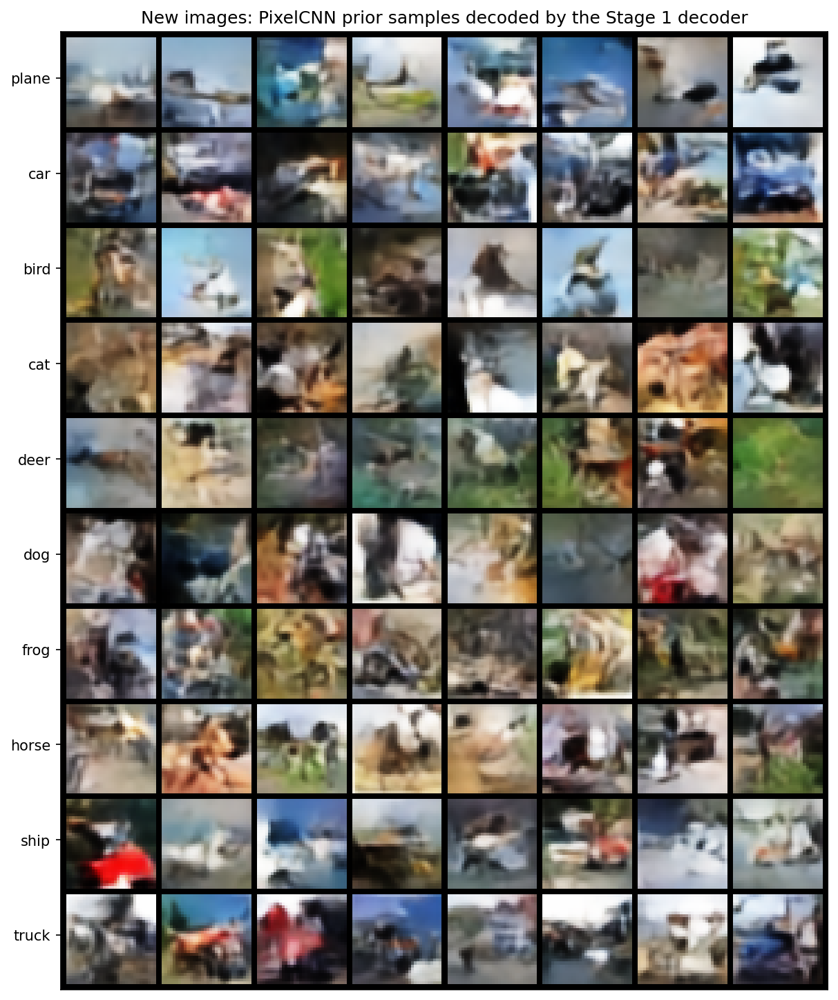

# VQ-VAE with a PixelCNN decoder (CIFAR-10)

A from-scratch PyTorch reimplementation of two papers, combined:

- **VQ-VAE**: van den Oord, Vinyals, Kavukcuoglu, [Neural Discrete Representation Learning](https://arxiv.org/abs/1711.00937) (2017)
- **Gated PixelCNN**: van den Oord et al., [Conditional Image Generation with PixelCNN Decoders](https://arxiv.org/abs/1606.05328) (2016)

A VQ-VAE compresses a 32x32 image into an 8x8 grid of discrete codes, each one of 512 learned codebook vectors. This repo trains that model, then replaces its deconvolution decoder with a conditional Gated PixelCNN, following Section 3.4 of the Gated PixelCNN paper ("PixelCNN Auto-Encoders"). The PixelCNN models p(x | z) one subpixel at a time, in raster order and R, G, B within a pixel, with the quantized latent z as the condition. An optional second model, a PixelCNN prior over the code grid, generates new images from scratch the way the VQ-VAE paper does.

## Models

| File | Model | Role |
|---|---|---|
| `vqvae/vqvae.py` | VQ-VAE with EMA codebook | Stage 1. Encoder, quantizer, deterministic decoder. |
| `vqvae/pixelcnn_decoder.py` | VQ-VAE + conditional Gated PixelCNN decoder | Main model. |
| `vqvae/pixelcnn_prior.py` | Class-conditional Gated PixelCNN over codes | Optional. Samples new 8x8 code grids. |
| `vqvae/losses.py` | SSIM, SSIM + L1 mix, 256-way pixel NLL | |

Stage 1 trains on 0.84 (1 - SSIM) + 0.16 L1, the mix recommended by Zhao et al., [Loss Functions for Image Restoration with Neural Networks](https://research.nvidia.com/publication/2017-03_loss-functions-image-restoration-neural-networks) (2017), plus the VQ commitment loss. The codebook updates by exponential moving average (EMA) rather than by gradient, and codes unused for about one epoch restart on random encoder outputs.

## Results

### Stage 1 VQ-VAE

Evaluated on all 10,000 CIFAR-10 test images (earlier notebook figures used only 8). Both checkpoints were trained for 100 epochs with the SSIM + L1 loss, codebook of 512 x 256, batch size 128.

| Checkpoint | Test SSIM | Test PSNR | Codes used | Code perplexity |
|---|---|---|---|---|
| `vqvae_stage1.pth` (default) | 0.842 | 25.37 dB | 512 / 512 | 460 |
| earlier run, same setup | 0.837 | 25.24 dB | 512 / 512 | 440 |

PSNR is computed per image with a data range of 2.0 (pixels in [-1, 1]) and then averaged.

### PixelCNN decoder: what went wrong the first time

The first PixelCNN decoder run trained everything from scratch and was stopped at epoch 3. By then the codebook had collapsed. Perplexity, the effective number of codes in use, was about 5 out of 512, and the commitment loss read 0.0000. A probe on one test batch gave 3.37 nats per subpixel with the real latent and 3.48 with the latent zeroed out. The decoder was getting almost nothing from z.

This is the posterior collapse problem that strong autoregressive decoders are known for. A PixelCNN can predict a pixel well from the pixels above and to its left, so early in training it learns to do that before the randomly initialized encoder has anything useful to say. The encoder then receives almost no gradient and settles on a handful of codes.

`train_pixelcnn_decoder.py` changes three things:

1. **Warm start.** The encoder, projection, and codebook load from the trained Stage 1 checkpoint, so z already describes the image on the first step.
2. **Frozen start.** Those parts stay frozen for the first 10 of 40 epochs, which forces the decoder to learn to read z before the encoder is allowed to move.
3. **Collapse monitoring.** Every epoch logs codebook perplexity and the *latent gap*, defined as test bits per dimension with z zeroed minus test bits per dimension with the real z. The script warns when the gap drops below 0.05 bits.

SSIM is not used to judge this model. A sample from p(x | z) is a new image that shares the content of the original, not a pixel-exact reconstruction, so its SSIM stays low even when the model works. The latent gap and bits per dimension are the right measures.

### PixelCNN decoder: fixed run

Trained for 40 epochs with batch size 128 and Adam, with the learning rate on a cosine schedule from 1e-3 to 1e-5. Epochs 0 to 19 ran on a Colab T4 and epochs 20 to 39 on a Kaggle T4. The second part resumed from the epoch 19 weights with a fresh Adam state, which is why train bits/dim jumps from 3.673 to 3.812 at epoch 20.

| Epoch | Encoder | Test bits/dim | Bits/dim, z zeroed | Latent gap | Code perplexity |
|---|---|---|---|---|---|
| 9 | frozen | 4.042 | 4.962 | 0.92 | 439 |
| 19 | trained | 3.717 | 5.107 | 1.39 | 448 |
| 39 | trained | 3.550 | 5.665 | 2.12 | 462 |

Test figures come from one fixed batch of 128 test images, the same batch every epoch. The latent gap grew after the encoder unfroze instead of shrinking, so the decoder uses z more as training goes on. The first run collapsed with a gap of about 0.17 bits and a perplexity of about 5.



Row 1 shows test images and rows 2 and 3 show two independent samples from p(x | z) for each one. Samples keep the layout and main colours of simple scenes such as the ship and the airplane. On cluttered scenes they keep the rough layout, but the colours drift.

### PixelCNN prior over codes

The class-conditional prior trains on the 8x8 code grids of the frozen Stage 1 model with cross-entropy, measured in bits per code. Guessing uniformly among 512 codes costs 9 bits. A first 60-epoch run reached its lowest test loss of 7.73 bits/code at epoch 5. After that train loss kept falling while test loss rose to 12.04, so the prior was memorizing the training grids. The Stage 1 codebook is used almost evenly (perplexity 460), so each image's code grid is close to unique and easy to memorize. The script now trains for 20 epochs and keeps the epoch with the lowest test loss.

| Run | Best epoch | Train bits/code | Test bits/code |
|---|---|---|---|
| 20 epochs, best kept | 4 | 7.578 | 7.739 |



Each row holds eight new images for one class, sampled from the prior and decoded by the Stage 1 decoder. The samples are blurry and rarely show a clear object, but the scene follows the class, with sky behind planes and birds and grass behind deer.

### Code fixes made while cleaning up

- `_ema_w` in the quantizer was an `nn.Parameter`, so it sat inside the optimizer. It is now a buffer.
- The EMA state started at cluster size 0 with random `_ema_w`, so any code missed in the first batch was divided by about 1e-5 and became a huge vector that could never win again. It now starts equal to the codebook.
- The dead-code threshold was 1.0, which reset any code used less than once per batch on every step. It is now 0.03, which works out to roughly one epoch without use.
- Old checkpoints still load through `load_stage1_checkpoint`, which maps the notebook-era layer names (`_encoder`, `_deconv_1`, ...) to the new ones.

## Running it

Training needs a GPU. `colab.ipynb` clones the repo, downloads the Stage 1 checkpoint from the `v0.1-stage1` release, runs the tests, then trains the PixelCNN decoder and the prior. Outputs are copied to Google Drive.

Locally, the tests run on CPU in about a second:

```bash
pip install -r requirements.txt
python -m pytest tests
```

The tests check shapes, that old checkpoints load, and causality. The causality tests change one input position at a time and assert that no output for an earlier position changes, for both the RGB decoder (including the R, G, B order inside a pixel) and the code prior. A masking bug there would let the model see the value it is predicting, which makes the loss look great and the samples useless.

Checkpoints are not stored in git. The Stage 1 checkpoint `vqvae_stage1.pth` is attached to the `v0.1-stage1` release and goes in `checkpoints/`.

## Layout

```
vqvae/                       model code
train_vqvae.py               Stage 1 (optional, checkpoint provided)
train_pixelcnn_decoder.py    main model
train_prior.py               optional prior over codes
colab.ipynb                  GPU runner
tests/test_models.py         CPU smoke and causality tests
```

## License

Code in this repository is licensed under the [MIT License](LICENSE).
